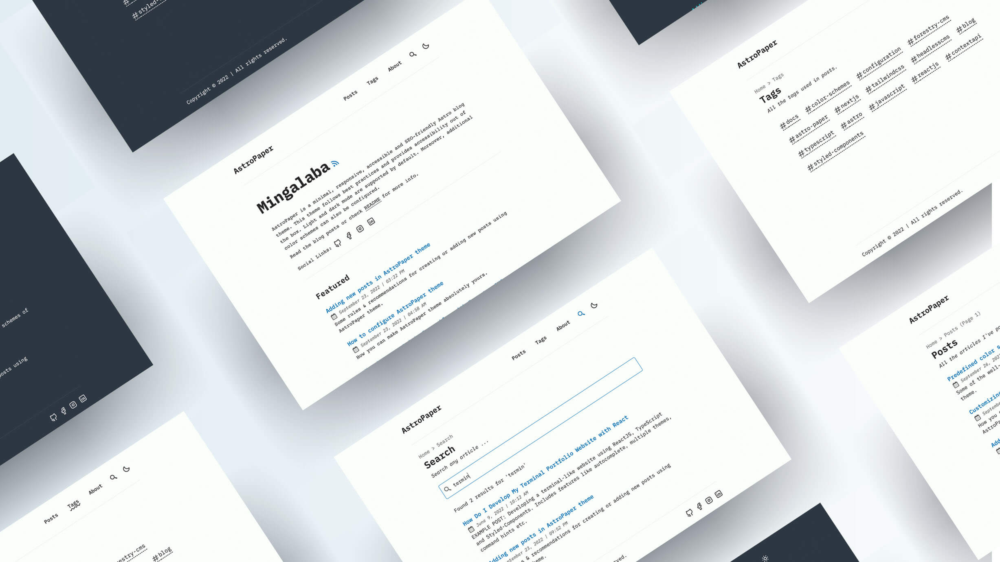

# AstroPaper 📄


[](https://www.figma.com/community/file/1356898632249991861)


[](https://conventionalcommits.org)
[](http://commitizen.github.io/cz-cli/)

AstroPaper is a minimal, responsive, accessible and SEO-friendly Astro blog theme. This theme is designed and crafted based on [my personal blog](https://satnaing.dev/blog).

Read [the blog posts](https://astro-paper.pages.dev/posts/) or check [the README Documentation Section](#-documentation) for more info.

## 🔥 Features

- [x] type-safe markdown
- [x] super fast performance
- [x] accessible (Keyboard/VoiceOver)
- [x] responsive (mobile ~ desktops)
- [x] SEO-friendly
- [x] light & dark mode
- [x] static search ([Pagefind](https://pagefind.app/))
- [x] draft posts & pagination
- [x] sitemap & rss feed
- [x] MDX support
- [x] collapsible table of contents
- [x] followed best practices
- [x] highly customizable
- [x] dynamic OG image generation for blog posts ([Blog Post](https://astro-paper.pages.dev/posts/dynamic-og-image-generation-in-astropaper-blog-posts/))
- [x] i18n ready

_Note: I've tested screen-reader accessibility of AstroPaper using **VoiceOver** on Mac and **TalkBack** on Android. I couldn't test all other screen-readers out there. However, accessibility enhancements in AstroPaper should be working fine on others as well._

## ✅ Lighthouse Score

<p align="center">
  <a href="https://pagespeed.web.dev/report?url=https%3A%2F%2Fastro-paper.pages.dev%2F&form_factor=desktop">
    
  </a>
</p>

## 🚀 Project Structure

Inside of AstroPaper, you'll see the following folders and files:

```bash
/
├── public/
│   ├── pagefind/          # auto-generated on build
│   ├── favicon.svg
│   └── default-og.jpg
├── contents/
│   ├── pages/
│   │   └── about.md
│   └── posts/
│       └── some-blog-posts.md
├── src/
│   ├── assets/
│   │   ├── icons/
│   │   └── images/
│   ├── components/
│   ├── i18n/
│   ├── layouts/
│   ├── pages/
│   ├── scripts/
│   ├── styles/
│   ├── types/
│   ├── utils/
│   ├── config.ts
│   └── content.config.ts
├── astro-paper.config.ts  # user-defined configurations
└── astro.config.ts
```

All blog posts are stored in the `contents/posts/` directory. You can organise posts into subdirectories — the subdirectory name becomes part of the post URL.

## 📖 Documentation

Documentation can be read in two formats\_ _markdown_ & _blog post_.

- Configuration - [markdown](src/content/posts/how-to-configure-astropaper-theme.md) | [blog post](https://astro-paper.pages.dev/posts/how-to-configure-astropaper-theme/)
- Add Posts - [markdown](src/content/posts/adding-new-post.md) | [blog post](https://astro-paper.pages.dev/posts/adding-new-posts-in-astropaper-theme/)
- Customize Color Schemes - [markdown](src/content/posts/customizing-astropaper-theme-color-schemes.md) | [blog post](https://astro-paper.pages.dev/posts/customizing-astropaper-theme-color-schemes/)
- Predefined Color Schemes - [markdown](src/content/posts/predefined-color-schemes.md) | [blog post](https://astro-paper.pages.dev/posts/predefined-color-schemes/)

## 💻 Tech Stack

**Main Framework** - [Astro](https://astro.build/)  
**Type Checking** - [TypeScript](https://www.typescriptlang.org/)  
**Styling** - [TailwindCSS](https://tailwindcss.com/)  
**UI/UX** - [Figma Design File](https://www.figma.com/community/file/1356898632249991861)  
**Static Search** - [Pagefind](https://pagefind.app/)  
**Icons** - [Tablers](https://tabler-icons.io/)  
**Code Formatting** - [Prettier](https://prettier.io/)  
**Deployment** - [Cloudflare Pages](https://pages.cloudflare.com/)  
**Linting** - [ESLint](https://eslint.org)  
**Dynamic OG images** - [Satori](https://github.com/vercel/satori) + [Sharp](https://sharp.pixelplumbing.com/) + [Astro Fonts](https://docs.astro.build/en/guides/fonts/)

## 👨🏻‍💻 Running Locally

이 저장소를 받은 뒤 프로젝트 루트에서 실행합니다. Node.js는 `22.12.0` 이상이 필요하며, GitHub Actions와 같은 환경을 쓰려면 Node.js 24와 pnpm 11.3.0을 사용합니다.

Corepack이 설치된 환경에서는 아래 명령으로 pnpm을 내려받고 의존성을 설치할 수 있습니다. 최초 실행에는 npm 레지스트리에 접근할 수 있어야 합니다.

```powershell
corepack pnpm@11.3.0 --version
corepack pnpm@11.3.0 install --frozen-lockfile
corepack pnpm@11.3.0 dev --host 127.0.0.1 --port 4321
```

브라우저에서 [로컬 블로그](http://127.0.0.1:4321/)를 엽니다. 서버가 출력하는 실제 주소와 포트를 확인하세요. 글을 저장하면 개발 서버가 변경 사항을 반영합니다.

pnpm 11.3.0이 이미 설치되어 있다면 `corepack pnpm@11.3.0` 대신 `pnpm`을 사용할 수 있습니다.

### 백그라운드 실행과 종료

현재 Astro 버전은 개발 서버의 백그라운드 실행을 지원합니다. 터미널을 계속 점유하지 않고 실행하려면 `--background`를 붙입니다. 상태 확인과 종료 명령도 같은 프로젝트 루트에서 실행합니다.

```powershell
corepack pnpm@11.3.0 dev --host 127.0.0.1 --port 4321 --background
corepack pnpm@11.3.0 astro dev status
corepack pnpm@11.3.0 astro dev logs
corepack pnpm@11.3.0 astro dev stop
```

### 글 주소와 초안

글은 `contents/posts/`에 작성하며, 하위 폴더도 URL에 포함됩니다. 예를 들어 `contents/posts/bootda/vibe-coding-chrome-extension.md`의 주소는 `/posts/bootda/vibe-coding-chrome-extension/`입니다.

현재 설정에서 `draft: true`인 글은 개발 서버와 배포 빌드 모두에서 제외되므로, 해당 주소로 접속해도 글이 표시되지 않습니다. `pnpm preview`는 빌드 결과를 확인하는 명령이며 초안 표시 기능을 제공하지 않습니다. 이 동작은 `src/utils/postFilter.ts`에서 확인할 수 있습니다.

### Windows에서 실행이 막힐 때

의존성이 설치된 상태라면 프로젝트의 Astro 실행 파일을 직접 사용할 수도 있습니다.

```powershell
.\node_modules\.bin\astro.cmd dev --host 127.0.0.1 --port 4321 --background
```

Astro 실행 중 사용자 설정 폴더의 `astro/Config` 생성 권한 오류가 발생하면, 현재 PowerShell 세션에서 텔레메트리를 끄고 다시 실행합니다.

```powershell
$env:ASTRO_TELEMETRY_DISABLED = "1"
.\node_modules\.bin\astro.cmd dev --host 127.0.0.1 --port 4321 --background
```

## Google Site Verification (optional)

You can add your [Google Site Verification HTML tag](https://support.google.com/webmasters/answer/9008080#meta_tag_verification&zippy=%2Chtml-tag) by setting `site.googleVerification` in `astro-paper.config.ts`:

```ts file="astro-paper.config.ts"
export default defineAstroPaperConfig({
  site: {
    // ...
    googleVerification: "your-google-site-verification-value",
  },
  // ...
});
```

> See [this discussion](https://github.com/satnaing/astro-paper/discussions/334#discussioncomment-10139247) for adding AstroPaper to the Google Search Console.

## 🧞 Commands

All commands are run from the root of the project, from a terminal:

| Command          | Action                                                                                                                           |
| :--------------- | :------------------------------------------------------------------------------------------------------------------------------- |
| `pnpm install`   | Installs dependencies                                                                                                            |
| `pnpm dev`       | Starts local dev server at `localhost:4321`                                                                                      |
| `pnpm build`     | Type-checks, builds the site, runs Pagefind indexing, and copies the index to `public/pagefind/`                                 |
| `pnpm preview`   | Preview your build locally, before deploying                                                                                     |
| `pnpm sync`      | Generates TypeScript types for all Astro modules. [Learn more](https://docs.astro.build/en/reference/cli-reference/#astro-sync). |
| `pnpm astro ...` | Run CLI commands like `astro add`, `astro check`                                                                                 |

## ✨ Feedback & Suggestions

If you have any suggestions/feedback, you can contact me via [my email](mailto:satnaingdev+astropaper@gmail.com). Alternatively, feel free to open an issue if you find bugs or want to request new features.

## 📜 License

Licensed under the MIT License, Copyright © 2026

---

Made with 🤍 by [Sat Naing](https://satnaing.dev) 👨🏻‍💻 and [contributors](https://github.com/satnaing/astro-paper/graphs/contributors).
